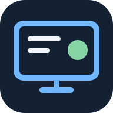
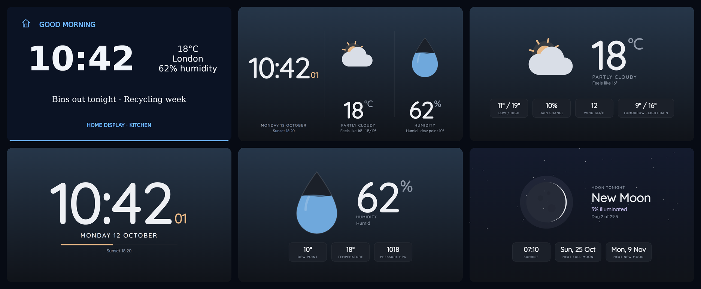
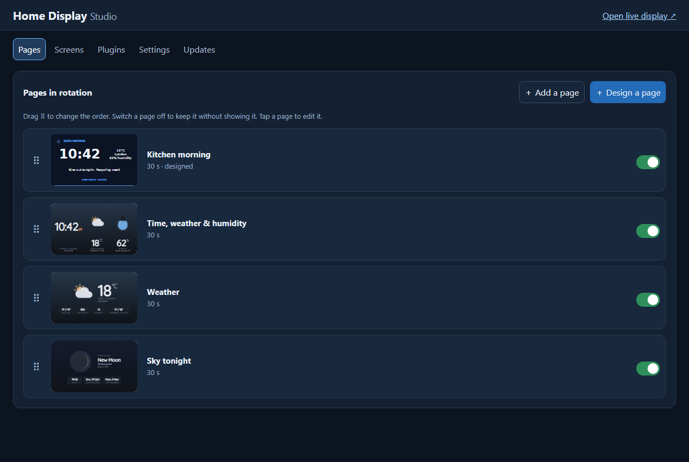
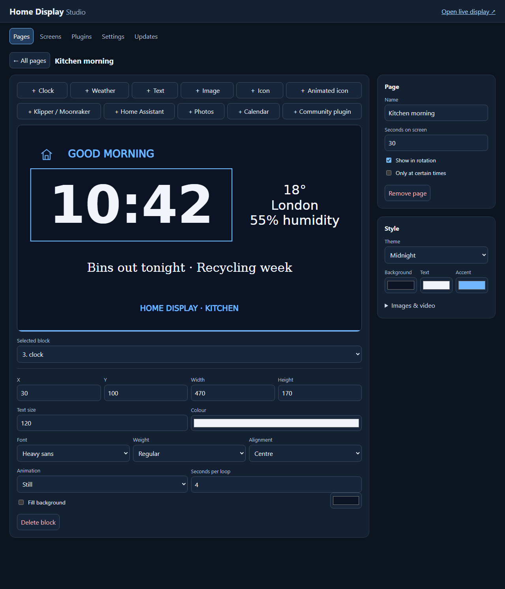
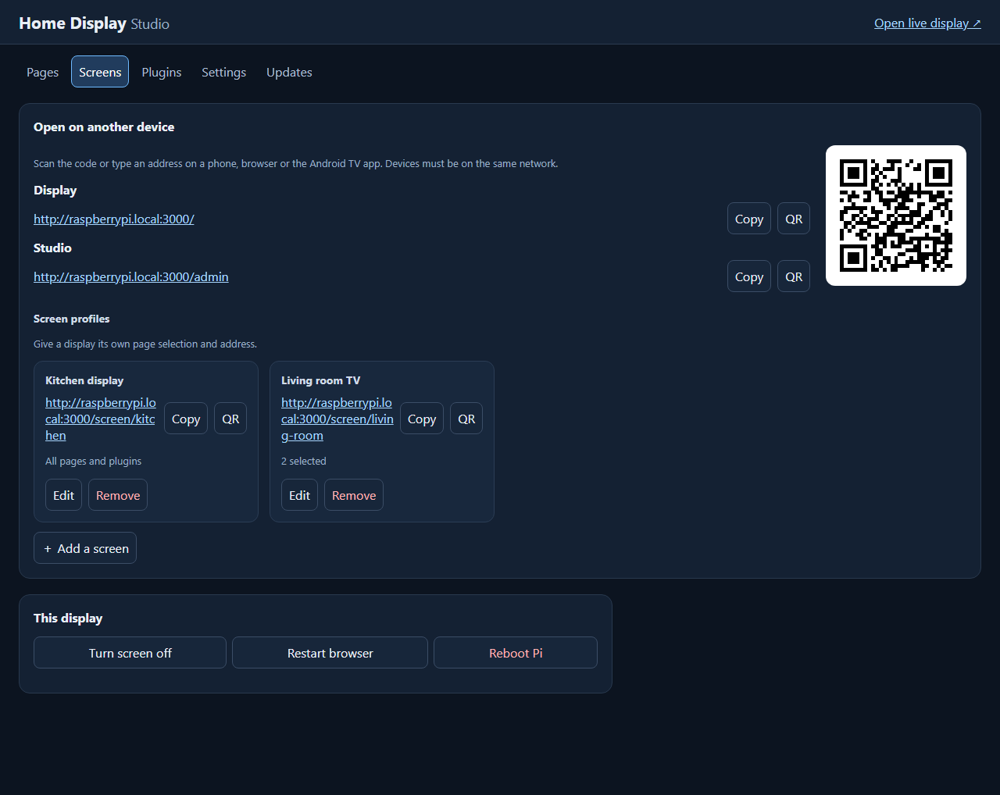
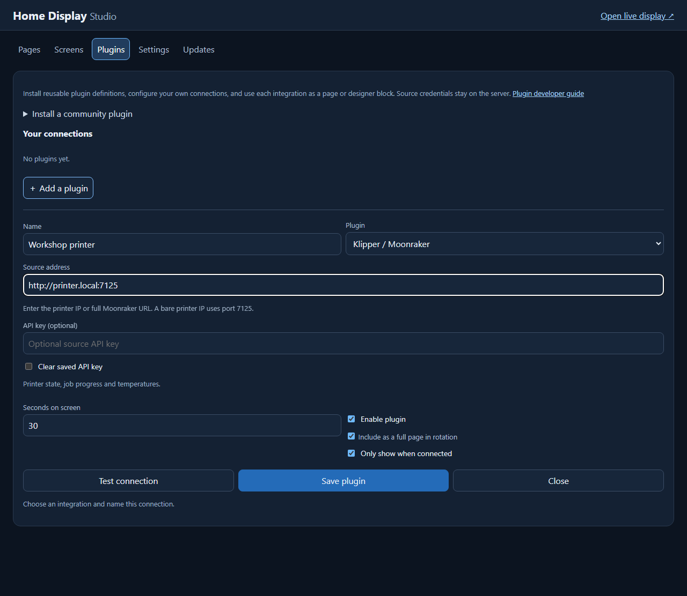

<p align="center"></p>

<h1 align="center">Home Display</h1>

<p align="center"><strong>A wall dashboard for your home that you design in the browser.</strong></p>

<p align="center">
  <a href="INSTALL.md">Install</a> ·
  <a href="https://github.com/lunnysteve/home-display/releases">Download</a> ·
  <a href="PLUGINS.md">Plugins</a> ·
  <a href="android-tv/README.md">Android TV</a> ·
  <a href="CHANGELOG.md">Changelog</a>
</p>



Home Display turns a Raspberry Pi and a small screen into a rotating dashboard for the time, the weather, the moon, your photos and calendar, and devices around the house such as a 3D printer or Home Assistant. You manage everything from a phone or laptop on the same network. No cloud account is needed, and everything runs on your own hardware.

## Features

- **Ready-made pages.** These include clock, weather, humidity, moon phase and sunrise, forecast, countdown, the ISS tracker and NASA's picture of the day. They're lightweight enough for a Raspberry Pi 2.
- **Visual page designer.** Drag clock, weather, text, image, icon, video and plugin blocks onto an 800 × 480 canvas. Choose colours, bundled or uploaded fonts and simple animations.
- **HTML editor.** Edit any page's HTML, CSS and JavaScript and preview a draft before you save it.
- **Multiple screens.** One server can drive several displays. Each screen has its own playlist and its own URL.
- **Home integrations.** Show Klipper/Moonraker printer status, Home Assistant entities, photo slideshows and Google Calendar or iCal agendas. Integrations that are offline can be hidden automatically.
- **Community plugins.** Install a plugin as a JSON definition and an HTML renderer. Credentials stay on the server.
- **Sleep schedule.** The screen blanks at night and wakes in the morning.
- **Safe updates.** Install new releases from the Studio. The checksum is verified first, and if the new version fails to start, the previous one is restored.
- **Android TV.** Use a TV as another screen, or as its screensaver.

## Quick start on a Raspberry Pi

You need a **Raspberry Pi 2 or newer**, an HDMI or official DSI display, and a microSD card flashed with **Raspberry Pi OS Lite (Bookworm or newer)**. Use [Raspberry Pi Imager](https://www.raspberrypi.com/software/) to set a username, Wi-Fi and SSH. On a Pi 2, use the 32-bit image.

Then, on the Pi:

```bash
sudo apt update && sudo apt install -y git
git clone https://github.com/lunnysteve/home-display.git
cd home-display
sudo bash install.sh
sudo reboot
```

The installer asks you to choose an admin password. After the reboot, the attached screen opens the dashboard. From another device, open **`http://YOUR-PI:3000/admin`** and sign in as `admin`.

If the Pi should only host the server, with no attached screen, use `sudo bash install.sh --server-only`. The [installation guide](INSTALL.md) covers hardware notes, the Pi 2 DSI screen workaround, backups and troubleshooting.

## Design your pages

The **Studio** at `/admin` has five sections: **Pages**, **Screens**, **Plugins**, **Settings** and **Updates**. It works on a phone as well as a computer.

**Pages** shows your rotation with live thumbnails. Drag pages into order, switch them on or off, or give a page a schedule, such as weekday mornings only. **Add a page** brings back any ready-made page or adds a web address.



Tap a page to edit it. On a designed page, add blocks, drag them into place, and choose fonts and colours. Changes collect in a bar at the bottom of the screen until you select **Save changes**.



## Run more than one screen

**Screens** shows the display's network address with a QR code to scan from a phone or TV. Create a profile for each extra display and choose which pages it shows. Screens also has buttons to turn the screen off, restart the display browser or reboot the Pi.



| URL | What it shows |
| --- | --- |
| `http://YOUR-PI:3000/` | The default rotation of all active pages |
| `http://YOUR-PI:3000/screen/kitchen` | A named screen profile |
| `http://YOUR-PI:3000/admin` | The Studio |

## Connect your home

Under **Plugins**, add a connection. Each connection can appear as a full page in the rotation, as a block inside a designed page, or as both. **Test connection** makes a real request from the server, and **Only show when connected** hides the plugin while the device is offline.



| Integration | What you need |
| --- | --- |
| Klipper / Moonraker | The printer address, e.g. `http://printer.local:7125`, and an API key if you set one |
| Home Assistant | Your server URL, a long-lived access token and the entity IDs to show |
| Photos | Uploaded images, a Google Photos export, or image URLs |
| Calendar | A Google Calendar iCal address, another iCal feed, an uploaded `.ics` file or a Home Assistant calendar |

To write your own plugin, see the [plugin guide](PLUGINS.md) and the [power-meter example](plugin-examples/).

## Android TV

1. Download `home-display-tv-vX.Y.Z.apk` from [Releases](https://github.com/lunnysteve/home-display/releases) and sideload it onto the TV.
2. Open **Home Display**, enter your server URL and pick a screen.
3. Optionally, choose Home Display as the TV's screensaver.

It needs Android 6 or newer. Whether the screensaver option appears depends on the TV's firmware. Android TV support is new, so reports from real devices are very welcome. See [Android TV setup](android-tv/README.md).

## Updates, backups and security

- **Updates.** **Updates** in the Studio checks GitHub for the latest release and installs it on Pi installations. Your settings, uploads, fonts, screens and plugins are kept in `/var/lib/home-display`.
- **Backups.** Before you reflash a card, copy `/var/lib/home-display` and `/etc/home-display`.
- **Security.** The Studio is protected by the admin password and is meant for a trusted home network. Put it behind an HTTPS reverse proxy before you expose it anywhere else. Uploaded HTML pages and plugins run in the display's browser, so only install ones you trust.

## Development

Home Display is a small Node.js (22 or newer) server with plain HTML, CSS and JavaScript pages. There is no build step.

```bash
npm ci
npm test
npm start          # http://localhost:3000 and http://localhost:3000/admin
```

To protect the Studio on a development machine, create a password hash and set it before you start the server:

```bash
export HOME_DISPLAY_ADMIN_PASSWORD_HASH="$(node password.js)"   # type a password, then Ctrl+D
```

The browser tests use Python, Playwright and Pillow:

```bash
python -m pip install playwright pillow
python -m playwright install chromium
python tests/studio-browser.py
python tests/designer-browser.py
python tests/plugin-browser.py
python tests/updater-rollback.py
python tools/capture-screenshots.py   # regenerates the images in this README
```

| Path | Contents |
| --- | --- |
| `server.js` | Express server, API and admin authentication |
| `*.html`, `lite.js`, `lite.css` | Display pages and the shared lightweight renderer |
| `studio.*`, `plugin-*.js` | The Studio and the plugin system |
| `app-files.json` | Core files that the Studio can't overwrite |
| `pi/` | Installer helpers, systemd units and kiosk session |
| `android-tv/` | Android TV viewer and screensaver |
| `tests/`, `tools/` | Automated checks and release tooling |

## Contributing

Bug reports, hardware test results, documentation fixes and plugin ideas are all welcome. When you report a problem, include your device model, OS version, Home Display version (shown under Updates) and the steps to reproduce it. Please keep credentials, personal settings and uploaded media out of issues and pull requests.

Release steps are in [RELEASING.md](RELEASING.md).

## Licence

Home Display is released under the [MIT Licence](LICENSE). The bundled DejaVu fonts have their own licence in [studio-font-license.txt](studio-font-license.txt).
